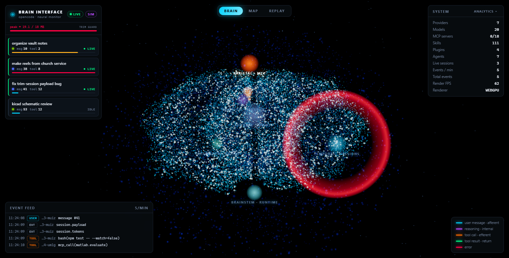
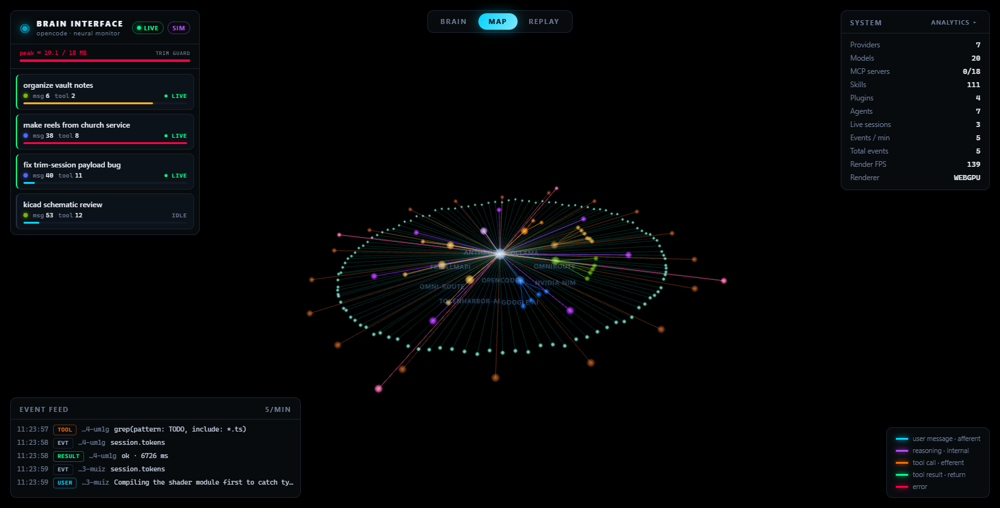
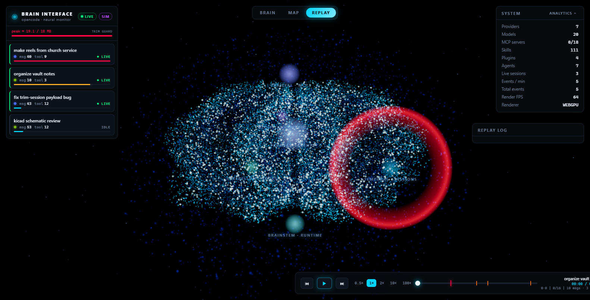

# ◉ Brain Interface

**A 3D neural visualization of your [opencode](https://opencode.ai) AI coding system — live sessions, architecture, replay, and analytics in one immersive interface.**

<p align="center">
  
</p>

Your AI agent's activity, rendered as a living brain: every user message, tool call, and result becomes a **neural impulse** flying between anatomical regions — planning in the *frontal* lobe, tool calls at *parietal*, memories in *temporal*, skills in *cerebellum*. Watch sessions live, explore the whole system as a constellation, replay any past session through time, and analyze your own usage patterns.

<p align="center">
  
  
</p>

---

## Features

| Mode | What it does |
|------|--------------|
| ◉ **BRAIN** | Live neural cloud (44k GPU-instanced points) — every event becomes an impulse; region orbs flash per event type; session cards with live counters and payload gauges |
| ◈ **MAP** | Your whole system as a clickable constellation: providers → models → agents → skills → MCP servers → plugins; dead skills dim, used skills swell |
| ⏪ **REPLAY** | Time-travel through any past session: scrub, 0.5×–100× speeds, frame stepping, bookmark ticks for tools/errors/file edits |
| 📊 **ANALYTICS** | Tool health (success rate + latency), 30-day activity sparkline, per-model token & cost economy, 7×24 "when you work" heatmap, problem-session detection with click-to-replay |

**Guard rails built in:** a payload-pressure gauge warns when any live session approaches the context-trim threshold, and error episodes cluster into "problem sessions" so bugs are one click away from a replay.

## Requirements

- **Node.js ≥ 24**
- A WebGPU-capable browser (Chrome/Edge 113+; Firefox 141+) — falls back to WebGL2 automatically
- **opencode** installed for live mode (works great in demo mode without it)
- Optional: a "second brain" vault folder (`Home.md` + `log.md` + `sessions/`) for session history & replay of past sessions
- OS: Windows / macOS / Linux (the auto-start helper is Windows-only; see below)

## Quick start (2 minutes)

```bash
git clone https://github.com/Dannnnn86/brain-interface.git
cd brain-interface
npm install
npm run build
npm start
```

Open **http://localhost:3030** — you'll see the brain idling with soft ambient impulses.

Want immediate action? Run the demo:

```bash
npm run sim
```

That starts the server with a built-in simulator generating realistic sessions (including ones that intentionally stress the payload gauge), plus a hot-reloading dev UI on http://localhost:4200.

## Connecting it to opencode (live mode)

1. Copy the reporter plugin into your opencode config:

   ```bash
   # from the repo root
   mkdir -p ~/.config/opencode/plugins/brain-interface
   cp plugin/brain-interface.js ~/.config/opencode/plugins/brain-interface/
   ```

2. Register it in `~/.config/opencode/opencode.jsonc`:

   ```jsonc
   {
     "plugin": [
       "./plugins/brain-interface/brain-interface.js"
       // ...your other plugins
     ]
   }
   ```

3. Restart opencode. The plugin is **zero-dependency and fail-silent** — it
   listens to session events and POSTs them to `http://127.0.0.1:3030/ingest`,
   never touching the model or your prompts.

Finished sessions also appear automatically: point the server at your vault
(see below) and it watches the `sessions/` folder for new transcripts.

## Connecting your vault (history + replay of past sessions)

The server discovers a "vault" folder by walking up from the working directory
looking for `Home.md` + `log.md` + `sessions/`. To pin one explicitly:

```bash
# option 1: environment variable
BRAIN_VAULT=/path/to/your/vault npm start

# option 2: machine-local config (gitignored)
echo '{ "vault": "/path/to/your/vault" }' > data/local.json
```

No vault? Everything still works — history features just stay off.

## Auto-start at logon (Windows)

```bash
npm run autostart:install   # registers a hidden scheduled task
npm run autostart:status
```

The task runs the production server invisibly at every logon and restarts it
up to 3× on crash. Manage with `autostart:stop / start / remove`.
(Linux/macOS: run `npm start` under your init system of choice — systemd user
service or launchd — same single command.)

## Modes & shortcuts

| Key | Action |
|-----|--------|
| `M` | toggle BRAIN ↔ MAP |
| `R` | enter replay (session picker) |
| `A` | toggle the analytics dashboard |
| `1`–`6` | fly to a brain region (frontal, temporal, parietal, occipital, cerebellum, brainstem) |
| `Space` | pause impulses (brain) / play-pause (replay) |
| `←` `→` | step replay frames |
| `Esc` | close panel / exit mode |

Deep links: `?mode=map`, `?mode=replay&session=<id>`, `?analytics=1`.

## How it works

```
opencode ──(plugin: zero-dep reporter)──►  ┌──────────────────────────┐
   │                                       │  brain server (Node)     │
   └──(vault transcripts)──(file watch)──►│  REST + WebSocket hub    │
                                           │  event recorder (jsonl)  │
                                           │  timeline + analytics    │
                                           └───────────┬──────────────┘
                                                       │ ws://…/ws
                                             ┌─────────▼─────────┐
                                             │ browser (WebGPU)  │
                                             │ three.js + TSL    │
                                             │ instanced sprites │
                                             │ anime.js HUD      │
                                             └───────────────────┘
```

- **Server** (`server/`, deps: `ws` + `chokidar` only): REST API, WebSocket
  hub, vault watcher, durable event recorder (`data/events/*.jsonl`), timeline
  builder, analytics aggregator, and a built-in simulator for demos.
- **Web** (`web/`, deps: `three` + `animejs`): TypeScript, no framework. The
  clouds are single-draw-call `THREE.Sprite`s driven by
  `instancedBufferAttribute`s (native WebGPU points are 1px — this is the
  documented workaround), with TSL bloom post-processing and automatic
  WebGL2 fallback.
- **Plugin** (`plugin/`): zero npm dependencies, fail-silent, fire-and-forget
  POSTs — it can never slow down or break your sessions.

### Data & privacy

Everything runs on `127.0.0.1`. Nothing leaves your machine. Session events
are recorded to local `data/events/*.jsonl` files (gitignored) — delete them
whenever you like. The interface itself makes **zero AI/API calls** and
consumes **zero tokens** at runtime.

## Development

```bash
npm run dev          # server + Vite dev UI with hot reload (:4200)
node scripts/smoke.js            # server end-to-end smoke test
node scripts/qa-interact.js      # headless interaction regression suite
node scripts/qa-shot.js <url> <out.png>   # zero-dep visual QA via CDP
node scripts/cdp-eval.js <url> "<js>"     # poke at the running app
```

The codebase is deliberately dependency-light and framework-free — see
`docs/superpowers/specs/` for the design document and `docs/superpowers/plans/`
for the milestone plans.

## Troubleshooting

| Symptom | Fix |
|---------|-----|
| Port 3030 busy | `BRAIN_PORT=3031 npm start` (or stop the auto-start task) |
| "WebGL fallback" in the SYSTEM panel | Your browser lacks WebGPU — update Chrome/Edge, or ignore: everything works on WebGL2 |
| No impulses in live mode | Check the connection badge is **LIVE**; verify the plugin is registered + opencode restarted; check the browser console |
| History/replay empty | Set `BRAIN_VAULT` or `data/local.json` — the SYSTEM panel shows whether a vault was found |
| Stale UI after an update | `npm run build`, then restart the auto-start task |

## License

[MIT](LICENSE) © Dannnnn86
